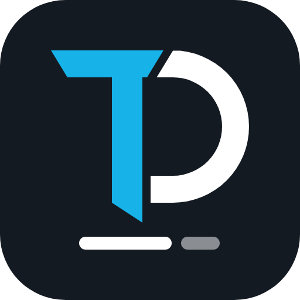

<p align="center"></p>

# Defta

Kodi için altyazı eklentisi. Altyazı bulur; istediğin dilde yoksa yapay zekâyla çevirir.

- **Arar:** OpenSubtitles, SubDL, SubSource ve Jimaku. Sonuçlar videoya uyma olasılığına göre sıralanır;
  makine yapımı altyazılar listede işaretlidir.
- **Çevirir:** Önce bulunduğun yerden birkaç dakikayı hızlıca, kalanını arka planda özenle (OpenAI ile).
  Yarıda kalan çeviri kaldığı yerden sürer.
- **Tutarlı yazar:** Her dizinin kendi sözlüğü olur; adlar bütün bölümlerde aynı yazılır.
- **Sıradaki bölüm:** İstersen sen izlerken hazırlar. Son seçtiğin altyazının devamını seçer.
- **Saklar:** Yapılan çeviri bir daha açıldığında ücretsiz yüklenir.
- Kodi 21 (Omega); Windows ve Android / Nvidia Shield. Ek kütüphane gerekmez.

## Kurulum

1. **Bilinmeyen kaynaklara izin ver:** Ayarlar → Sistem → Eklentiler → *Bilinmeyen kaynaklar*.
2. **Kaynağı ekle:** Ayarlar → Dosya yöneticisi → *Kaynak ekle* → `https://thatess.github.io/defta/` yaz → ad olarak `Defta` yaz.
3. **Depoyu kur:** Eklentiler → Eklenti tarayıcısı → *Zip dosyasından yükle* → `Defta` → `repository.defta-2.0.2.zip`.
4. **Defta'yı kur:** *Depodan yükle* → *Defta Repo* → *Altyazılar* → *Defta* → Yükle.
5. **Varsayılan servis yap:** Ayarlar → Oynatıcı → Dil → *Varsayılan dizi servisi* ve *Varsayılan film servisi* → Defta.

Kaynak eklemek istemezsen 2. adım yerine [`repository.defta-2.0.2.zip`](https://github.com/thatess/Defta/raw/main/repository.defta-2.0.2.zip)
dosyasını cihaza indir ve 3. adımda onu seç.

### Güncelleme

Depo kuruluyken Kodi yeni sürümü kendisi görür. Nasıl kurulacağını sen seçersin
(Ayarlar → Sistem → Eklentiler → *Güncellemeler*):

- *Güncellemeleri otomatik kur:* yeni sürüm kendiliğinden kurulur.
- *Bildir, ama kurma:* yeni sürüm Eklentiler → **Güncellemeler** bölümünde görünür, oradan elle kurarsın.

### Deftalpha (ilk sürüm)

Defta baştan yazılmadan önceki ilk sürüm depoda **0.4.35 (Deftalpha)** olarak durur; geliştirilmiyor.
Kurmak istersen: Defta'nın sayfası → *Sürümler* → 0.4.35. İkisi aynı eklentinin sürümleridir ve aynı veri klasörünü
kullanır; birinden ötekine geçerken eklentiyi verisiyle kaldırıp yeniden kur.

Depoyu kurmadan yalnız eklentinin zip dosyasını da kurabilirsin (`depo/service.subtitles.defta/`); o zaman Kodi yeni
sürümleri göremez.

## Anahtarlar

Defta ayarları → **Siteler ve anahtarlar**:

| Ne | Nereden | Gerekli mi |
|---|---|---|
| OpenAI API anahtarı | platform.openai.com → API keys | Çeviri için evet |
| OpenSubtitles API anahtarı (istersen kullanıcı adı ve parola) | opensubtitles.com → hesabın → API consumers | Hayır |
| SubDL API anahtarı | subdl.com → hesap → API | Hayır |
| SubSource API anahtarı | subsource.net → hesap → API | Hayır |
| Jimaku API anahtarı | jimaku.cc → hesap | Hayır (anime, Japonca) |

Anahtarı olmayan site atlanır. Kumandayla yazmak zorsa anahtarları bir `.txt` ya da `.env` dosyasına satır satır yaz
(`OPENAI_API_KEY=...`, `SUBDL_API_KEY=...` gibi) ve **Anahtarları dosyadan yükle** ile seç.
**Anahtarları test et** hepsini dener. Ekranda anahtarın yalnız son 4 karakteri görünür.

Çeviri OpenAI hesabından ücretlendirilir; eklentinin kendisi ücretsizdir.

## Bu depoda ne var

| Klasör | İçinde |
|---|---|
| `depo/` | Kodi'nin okuduğu dosyalar: Defta'nın güncel paketi, Deftalpha paketi ve depo eklentisi |
| `eklenti/` | Kodi eklentisinin kaynağı ve testleri |
| `cekirdek/` | Çeviri çekirdeği (Kodi olmadan bilgisayarda da çalışır, bkz. `cekirdek/OKUBENI.md`) |
| `deftalpha/` | Hatıra: ilk Defta'nın kaynağı (0.4.34). Geliştirilmiyor |
| `araclar/` | Depo dosyalarını üreten betik ve depo eklentisinin kaynağı |

### Yeni sürüm yayımlamak

```
python eklenti/araclar/paketle.py
```

Çıkan zip dosyasını `depo/service.subtitles.defta/` klasörüne koy, `python araclar/depo_uret.py` çalıştır, gönder.
Depoda Defta'nın yalnız en yeni paketi tutulur; eskisini betik siler.

## Lisans

MIT
